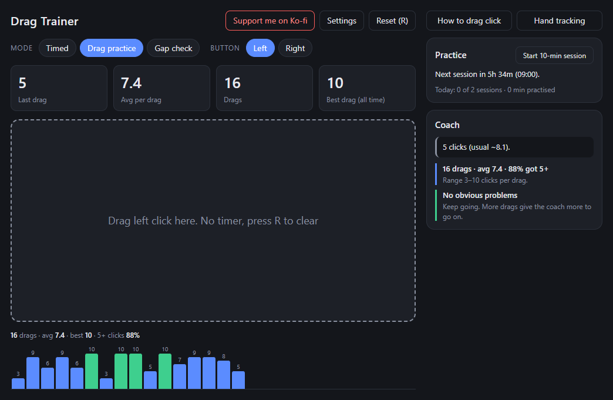
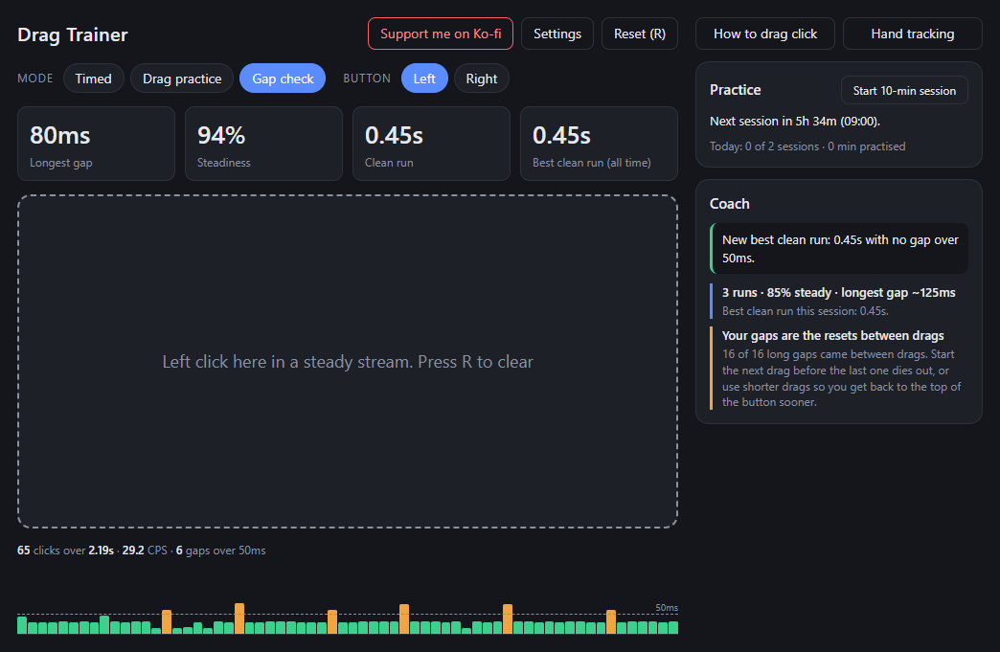
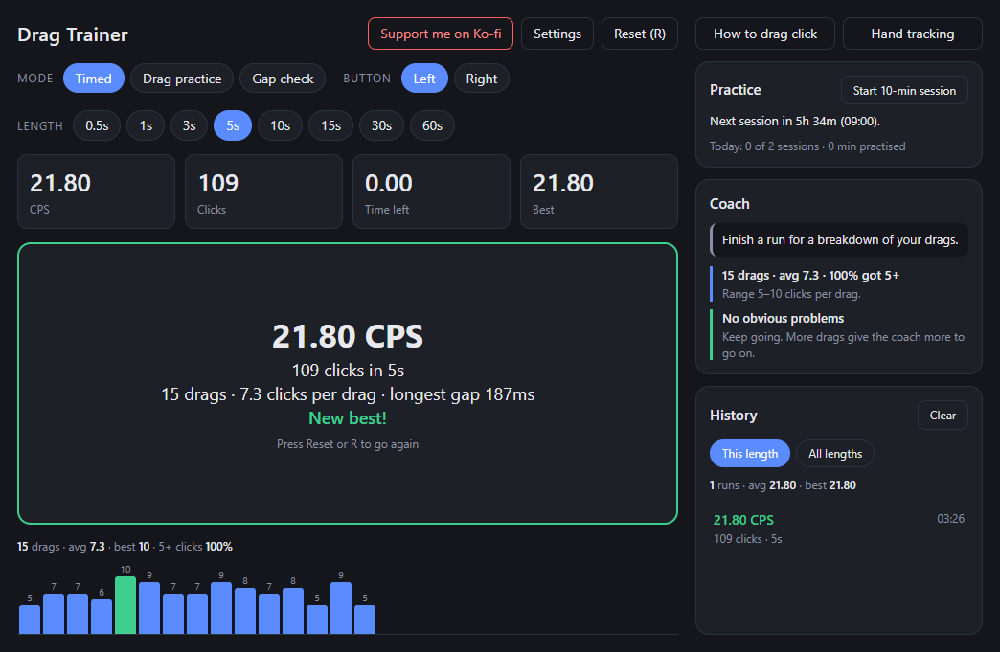
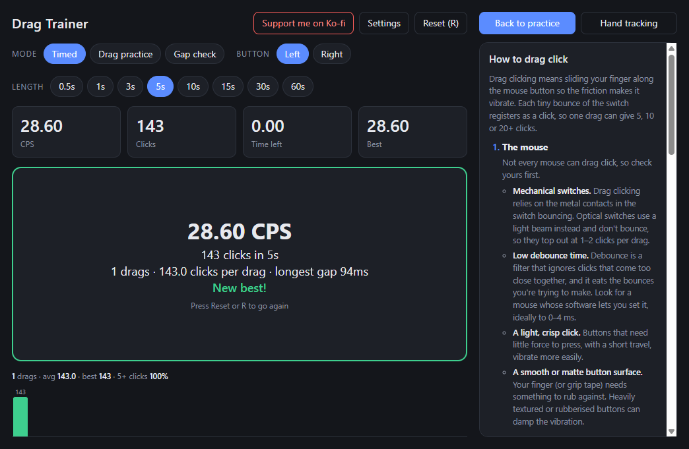

# Drag Trainer

**HAVE YOU EVER wanted to learn how to drag click?!**

Are you TIRED of mashing your mouse and getting a measly 8 CPS? Do you slide your finger across the button, full of hope, only to get... *two clicks*?! Are your friends out-clicking you, out-bridging you, out-*everything*-ing you?

**WELL, I'VE GOT THE APP FOR YOU!**

Introducing **Drag Trainer**! It counts **every click in every drag**, has a **coach** that tells you what went wrong, **reminds you when to practise** (and when to STOP), and comes with a **step-by-step guide** to get you started!

*But wait, there's more!* It's **completely FREE**, it's **open source**, and there's **no installer**: just download it and click!

**Order now!** *(Please don't phone anyone. It's a GitHub release.)*



---

## Why I made this

Okay, the infomercial voice was a joke, but this part isn't. I made Drag Trainer because I couldn't drag click. I'd watched people do it, bought grip tape, and tried for ages, and I still only got two clicks a drag. Online guides all said the same thing ("just drag your finger across it"), and none of them helped me work out what *I* was doing wrong.

So I built the tool I wished I'd had: one that counts the clicks in every drag, shows whether I'm getting better, and gives me an idea of what to change. I'm still learning with it myself. If you're stuck at two clicks too, I hope it helps you as much as it's helping me.

## What it does

- **Timed CPS tests.** 0.5 to 60 seconds, left or right click, with history and a best score for each length.
- **Drag practice mode.** There's no timer: it counts the clicks in each drag and draws a bar for each one, so you can see how consistent you are.
- **Gap check.** A bar for every click showing the gap before it, with a 50ms line, so you can see exactly where your clicking pauses. It tracks your longest gap, how steady you are and your longest clean run, and the Coach tells you whether your gaps come from slow resets or drags fading out. An optional **Bridge coach** (in Settings) also says whether you're steady enough to god bridge in Minecraft.
- **Coach.** It reacts to every drag ("New best drag: 11 clicks! Copy exactly what you just did") and writes a session report: inconsistent drags, drags that stall partway, fading as you tire, standout drags worth copying, and whether slow resets are holding your CPS back.
- **Practice sessions and reminders.** Guided 10-minute sessions of 10 seconds dragging, 10 seconds resting. While the app is open, it sends a Windows notification when your next session is due and tells you when to stop.
- **How to drag click.** A built-in guide covering which mice can do it, finger position, pressure, consistency, resets and grip tape.
- **Hand tracking** *(v1.1)*. Point your phone's camera at your mouse hand, and after every drag the app tells you what your finger did: its angle, where on the button the drag started, how far and fast it moved, and whether it lifted. After 8 drags it compares your best and worst drags to show what actually works *for you*, e.g. "your best drags start in the front third of the button", and marks that spot on the camera preview. [Set it up](#hand-tracking-setup).
- **Drag replays** *(v1.1)*. Turn on recording and it saves your 3 best and 3 worst drags from each session, with what made each one good or bad. Watch them back in slow motion or frame by frame, with every click marked. Switch each marking (hand, finger, button line, target spot, click flash) on or off, or hide them all to see just your hand.

| Gap check | Timed test |
|---|---|
|  |  |

| Guide | |
|---|---|
|  | |

## Download

Drag Trainer is for **Windows 10 and 11**, and comes in two versions. Pick the one you want:

| | **v1.0: no hand tracking** | **v1.1: hand tracking** |
|---|:---:|:---:|
| CPS tests, drag practice, gap check, coach, practice reminders, guide | ✅ | ✅ |
| Hand tracking with a phone or webcam | ❌ | ✅ |
| Recorded replays of your best and worst drags | ❌ | ✅ |
| Uses your camera | Never | Only when you turn it on |
| Download size | ~110MB | ~119MB |
| | **[Download v1.0](https://github.com/urmamge/drag-trainer/releases/download/v1.0.1/Drag-Trainer.exe)** | **[Download v1.1](https://github.com/urmamge/drag-trainer/releases/download/v1.1.1/Drag-Trainer.exe)** |

**Not sure?** Get **v1.1**. Hand tracking stays off until you switch it on, so until then it works just like v1.0. Pick **v1.0** if you don't want camera features at all, or want a slightly smaller download.

Both versions share the same saved scores and practice history, so you can switch between them at any time. Features that don't need a camera, like Gap check, go into both versions. Release notes for each version are on the [releases page](https://github.com/urmamge/drag-trainer/releases).

## Install

1. Download **`Drag-Trainer.exe`** for the version you picked above.
2. Double-click it. There's nothing to install; the exe *is* the app. You can keep it anywhere, such as your Desktop or Documents.
3. **If Windows shows "Windows protected your PC"**, click **More info**, then **Run anyway**. You only need to do this once. [Why does this happen?](#why-does-windows-warn-me)
4. It takes a few seconds to open, because it unpacks itself each time it starts.

Keep it open (minimizing is fine) if you want practice reminders. Closing the window quits it completely; nothing keeps running in the background.

**To uninstall:** delete `Drag-Trainer.exe`. To also remove your scores, practice history and replays, delete the `%APPDATA%\Drag Trainer` folder.

## Hand tracking setup

> [!NOTE]
> Hand tracking is a work in progress. Better optimisation and bug fixes are coming in future updates.

*For v1.1 only.* Hand tracking needs a side view of your hand on the mouse, which a webcam pointed at your face can't give. **Using your phone as the camera is recommended**, because it's easy to place and usually has a better camera.

1. **Connect your phone as a camera.**
   - **Android and Windows 11:** open Settings → Bluetooth & devices → Mobile devices, allow this PC to access your mobile devices, and link your phone with the Link to Windows app. On recent Windows 11 versions, your phone's camera then appears as a camera on your PC.
   - **Any phone, iPhone or Android:** install a free phone-webcam app such as Iriun Webcam, DroidCam or Camo on both your phone and your PC. Connect them over the same Wi-Fi, or a USB cable for less lag.
   - If the app has a 60fps option, turn it on.
2. **Place it.** Turn the phone on its side, level with the top of your mouse, about 20–30cm away, filming your clicking finger side-on. For a right-handed mouse, put it on the left. Keep your whole hand and wrist in shot, use good lighting, and prop the phone up so it can't move.
3. **Start it.** In Drag Trainer, click **Hand tracking**, pick your phone from the camera list and press **Start camera**. A preview appears next to the click pad, with your finger highlighted in green.
4. **Calibrate.** Press **Mark back**, and within 3 seconds hold your clicking fingertip on the back of the button. Then press **Mark front** and hold it on the front edge. This shows the app where your button is, so it can tell you *where* on the button to drag. Do it again if you move the camera.
5. **Record (optional).** Tick **Record my drags** to keep clips of your best and worst drags. Open them with **Replays**. Clips are saved only on your PC, and the last 10 sessions are kept.
6. **Drag.** Use Drag practice mode or a practice session. The Coach adds what your hand did after each drag.

The camera can't see pressure or the vibration itself, so it can't catch everything. Distances in cm are rough, because they're based on an average hand size.

## Is it safe?

Downloading an exe from GitHub should make you a bit suspicious, so here's everything you need to decide for yourself.

**What it does and doesn't do**

- It doesn't need admin rights and doesn't change any system settings.
- It makes no network requests of its own. There's no telemetry, no accounts and no ads. The only link is the "Support me on Ko-fi" button, which opens the page in your normal browser when you click it.
- **v1.0 never uses your camera.** **v1.1 only uses it when you turn on hand tracking**, and neither version ever uses your microphone. In v1.1, the video is analysed live on your PC by Google's open-source [MediaPipe](https://ai.google.dev/edge/mediapipe/solutions/vision/hand_landmarker) hand tracker, which is bundled inside the app. The video is never sent anywhere, and it's only saved if you turn on **Record my drags**, which keeps short clips of your best and worst drags on your PC. You can delete them all from the Replays screen.
- Your scores and practice history are saved only on your PC, in `%APPDATA%\Drag Trainer`.
- It doesn't read your clicks outside its own window. It only counts clicks on the grey pad.

**You can check the download came from this code**

- **All the code is here.** It's a small Electron app; the logic is in [`src/`](src) and the interface is in [`static/`](static).
- **GitHub builds the exe, not me.** Releases are built by [GitHub Actions](.github/workflows/release.yml) on GitHub's own servers, straight from the tagged source. You can see the build log for every release in the [Actions tab](https://github.com/urmamge/drag-trainer/actions).
- **Every build is attested.** GitHub signs a record that says which repo, commit and workflow produced the exe. With the [GitHub CLI](https://cli.github.com/) installed, check your download with:
  ```
  gh attestation verify Drag-Trainer.exe --repo urmamge/drag-trainer
  ```
- **Checksum.** Each release includes `SHA256SUMS.txt`. Compare it with your download in PowerShell:
  ```powershell
  Get-FileHash .\Drag-Trainer.exe -Algorithm SHA256
  ```
- **Scan it yourself.** Upload the exe to [VirusTotal](https://www.virustotal.com/) to have dozens of antivirus engines check it.
- **Or don't trust the exe at all**, and [build it yourself](#build-it-yourself) from the source.

### Why does Windows warn me?

Windows SmartScreen warns about any program that isn't **code-signed** and hasn't been downloaded by lots of people yet. A code-signing certificate costs hundreds of pounds a year, which doesn't make sense for a free hobby project. The warning means "Windows doesn't know who made this", not "this is a virus". The checks above let you confirm that for yourself.

## Build it yourself

You need [Node.js](https://nodejs.org/) 22 or newer.

```
git clone https://github.com/urmamge/drag-trainer.git
cd drag-trainer
npm ci
npm start          # run it straight from the source
npm run dist       # or build release/Drag-Trainer.exe
```

That builds the latest version. For v1.0 (no hand tracking), run `git checkout v1.0.1` before `npm ci`.

The first build downloads Google's MediaPipe hand model (about 8MB) and checks it against a pinned checksum. After that, everything runs offline.

If `npm start` complains that Electron failed to install, newer npm versions block install scripts by default. Run `node node_modules/electron/install.js` once, then try again.

## The science bit

The practice schedule is based on motor-learning research, not guesswork:

- **10s drag / 10s rest sets.** Early skill gains mostly happen during short rests between practice, not during the practice itself ([Bönstrup et al., 2019, *Current Biology*](https://doi.org/10.1016/j.cub.2019.02.049)).
- **Short sessions, spread out.** Spaced-out practice beats long sessions for motor skills ([Lee & Genovese, 1988](https://doi.org/10.1080/02701367.1988.10609373)), and drag clicking is hard on your hand.
- **6+ hours apart, at most 2 a day.** New motor skills take hours to settle in ([Shadmehr & Brashers-Krug, 1997](https://doi.org/10.1523/JNEUROSCI.17-01-00409.1997)) and keep improving overnight while you sleep ([Walker et al., 2002](https://doi.org/10.1016/S0896-6273(02)00746-8)).

The exact numbers (10 minutes, 6 hours, 2 a day) are my choices based on those findings; the studies don't prescribe them for drag clicking specifically.

The coach only knows *when* each click happened. It can't see your finger, so its tips describe the most likely cause rather than a certain one.

## A word of warning

Some game servers limit or flag very high CPS. Check the rules where you play before you show off your new skills.

## License

[MIT](LICENSE). Hand tracking uses [MediaPipe](https://github.com/google-ai-edge/mediapipe) and its hand landmark model, which are © Google and licensed under [Apache 2.0](https://www.apache.org/licenses/LICENSE-2.0).
